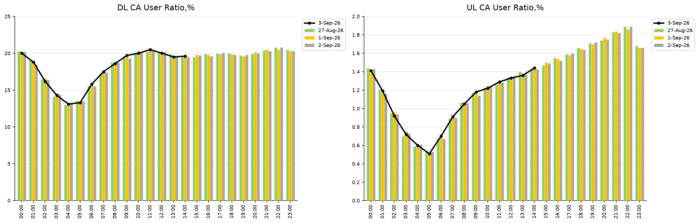

# RAN KPI Dashboard Preparation with Python

Beginner-friendly Jupyter notebook that draws **RAN KPI charts** in the same style as a typical Excel report.

The first example is **Carrier Aggregation (CA) User Ratio**:

- Left: **DL CA User Ratio, %**
- Right: **UL CA User Ratio, %**
- Green / yellow / gray **bars** = previous days
- Black **line** = latest day (partial day is allowed)



## What is in this folder

| File or folder | What it is |
|---|---|
| `01_CA_User_Ratio_Beginner.ipynb` | **Start here.** Step-by-step notebook. |
| `data/sample_ca_kpi.xlsx` | Sample Excel file (2 sheets, like the report). |
| `data/sample_ca_raw_counters.csv` | Sample OSS counters, used to **calculate** the KPI. |
| `output/` | Saved chart pictures after you run the notebook. |
| `requirements.txt` | Python packages to install. |

## How to run (slow, for beginners)

### 1. Install Python

If Python is not installed, the easiest option is [Anaconda](https://www.anaconda.com/download) (it includes Jupyter).

### 2. Open a terminal in this project folder

```bash
pip install -r requirements.txt
jupyter notebook
```

### 3. Open the notebook

In the Jupyter page, click:

`01_CA_User_Ratio_Beginner.ipynb`

### 4. Run it cell by cell

1. Click the first cell.
2. Press **Shift + Enter**.
3. Repeat until the end.

Or use the menu: **Kernel → Restart & Run All**.

You should see two charts side by side, similar to the Excel sample.

## How to use your own network data

1. Keep the same Excel layout as `data/sample_ca_kpi.xlsx`.
2. Keep these two data sheets:
   - `DL_CA_User_Ratio`
   - `UL_CA_User_Ratio`
3. First column name: `Hour` (`00:00`, `01:00`, ... `23:00`).
4. Other columns: one column per date.
5. In the notebook, change the file path in **Step 8**.

If your OSS export is counters instead of percentages:

```text
DL CA User Ratio % = DL_CA_Users / Avg_RRC_Users * 100
UL CA User Ratio % = UL_CA_Users / Avg_RRC_Users * 100
```

Step 7 in the notebook shows this with the sample counter file.

## Reuse for other RAN KPIs

The chart function works for any hourly KPI with the same table shape, for example:

- DL / UL PRB Utilization %
- RRC Setup Success Rate %
- ERAB Drop Rate %
- Handover Success Rate %
- User Throughput (Mbps)

Only the title and the Y-axis maximum usually need to change. See **Step 9** in the notebook.
