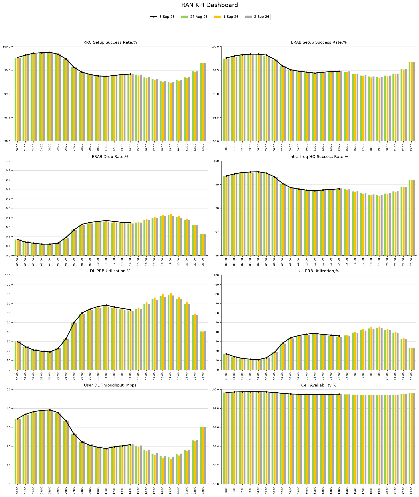

# RAN KPI Dashboard Preparation with Python

Beginner-friendly Jupyter notebook that builds a **RAN KPI dashboard** in the same style as a typical Excel report:

- Green / yellow / gray **bars** = previous days
- Black **line** = latest day (partial day is allowed)
- **One Excel sheet = one KPI**
- The same code draws **every** KPI: accessibility, retainability, mobility, utilization, throughput, availability, CA, and anything else with the same table shape

Practice data is included so you can learn today. Your live OSS Excel can replace it later.



## What is in this folder

| File or folder | What it is |
|---|---|
| `01_RAN_KPI_Dashboard_Beginner.ipynb` | **Start here.** Step-by-step notebook. |
| `data/sample_ran_kpi_dashboard.xlsx` | Practice workbook (many KPI sheets). |
| `data/YOUR_KPI_TEMPLATE.xlsx` | Empty template to copy for your own file. |
| `output/` | Saved dashboard picture after you run the notebook. |
| `requirements.txt` | Python packages to install. |

## How to run (slow, for beginners)

### 1. Install Python

If Python is not installed, the easiest option is [Anaconda](https://www.anaconda.com/download) (it includes Jupyter).

### 2. Open a terminal in this project folder

```bash
pip install -r requirements.txt
jupyter notebook
```

### 3. Open the notebook

Click `01_RAN_KPI_Dashboard_Beginner.ipynb`.

### 4. Run it cell by cell

1. Click the first cell.
2. Press **Shift + Enter**.
3. Repeat until the end.

Or use the menu: **Kernel → Restart & Run All**.

## Excel layout (this is the contract)

Each KPI sheet:

| Hour | Date1 | Date2 | Date3 | Date4 |
|---|---|---|---|---|
| 00:00 | | | | |
| ... | | | | |
| 23:00 | | | | |

There is also a `KPI_Settings` sheet:

| Sheet_Name | Title | Y_Min | Y_Max | Y_Step |
|---|---|---|---|---|
| DL_PRB_Utilization | DL PRB Utilization,% | 0 | 100 | 10 |
| ERAB_Drop_Rate | ERAB Drop Rate,% | 0 | 1 | 0.1 |

Add a new KPI by adding a sheet **and** one row in `KPI_Settings`. No Python change is required.

If your real OSS export looks different, keep the file. The notebook can be adapted when that sample arrives.

## When your network Excel is ready

1. Put the file in the `data` folder.
2. In the notebook Step 3, change `excel_path`.
3. Run all cells again.
